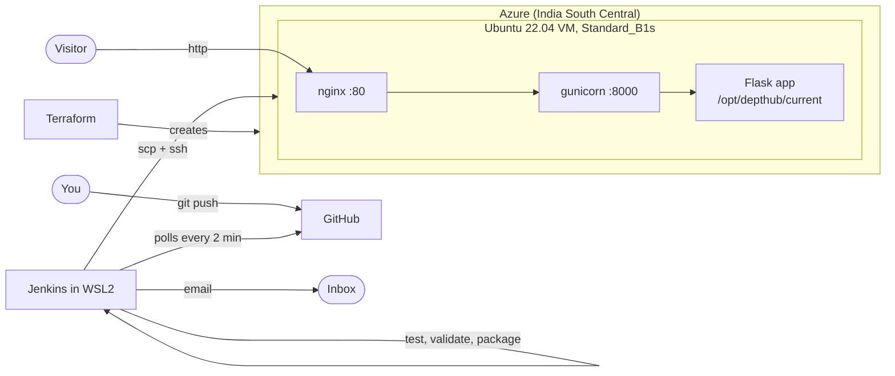

# DeptHub

**An auto-updating department portal, deployed to Azure with Terraform and a Jenkins CI/CD pipeline.**

DeptHub is the notice board and student showcase for the **Department of Artificial Intelligence and Data Science, Karunya Institute of Technology and Sciences**. Edit a JSON file, `git push`, and about two minutes later the live website on Azure updates itself. Every change is tested and checked first, and if a new version is broken, the server **rolls back automatically** and sends an email.

| | |
|---|---|
| Live site (while the Azure VM exists) | http://172.198.62.151/ |
| Repository | https://github.com/mikey1803/depthub |
| Jenkins (local) | http://localhost:8080/job/depthub/ |
| Full explanation for the report / viva | [docs/project-explained.md](docs/project-explained.md) |

> **Build status:** Jenkins runs on a laptop (WSL2), so there is no public build badge. See [Build status badge](#build-status-badge).

---

## Contents

1. [What it does](#1-what-it-does)
2. [How it works](#2-how-it-works)
3. [Tech stack](#3-tech-stack)
4. [Repository layout](#4-repository-layout)
5. [Quick start: run it on your computer](#5-quick-start-run-it-on-your-computer)
6. [Full setup: Azure + Jenkins, step by step](#6-full-setup-azure--jenkins-step-by-step)
7. [Everyday use: post a notice](#7-everyday-use-post-a-notice)
8. [Starting everything again after a reboot](#8-starting-everything-again-after-a-reboot)
9. [Demo: continuous deployment and rollback](#9-demo-continuous-deployment-and-rollback)
10. [Troubleshooting](#10-troubleshooting)
11. [Costs and cleanup](#11-costs-and-cleanup)
12. [More documentation](#12-more-documentation)

---

## 1. What it does

### The website

| Page | URL | What you see |
|---|---|---|
| Notice board | `/` | Active notices. Urgent ones pinned at the top in red, colour tags per category, category filter, and a live "Next deadline" countdown |
| Notice detail | `/notice/<id>` | One notice with its dates, a live countdown and a QR code |
| QR code | `/qr/<id>` | PNG QR code that opens that notice on a phone |
| Student showcase | `/students` | Portfolio cards; click a skill (e.g. Python) to see only students who have it |
| Deployments | `/deploys` | Every deployment: build, commit, message, author, time, and Live / Deployed / Rolled back |
| Health check | `/health` | `200 {"status":"ok"}` only if both data files load and are valid, otherwise `500` |

Also on every page:
- A footer badge such as `v8 · commit 836d046 · deployed 3 minutes ago`.
- A dark mode toggle that remembers your choice.
- An Apple-inspired design in plain CSS: system font, frosted top bar, rounded cards, light and dark themes, gentle animations (switched off for reduced motion).

### Smart behaviour
- **No database.** Content lives in `data/notices.json` and `data/students.json`.
- **Notices expire by themselves** after their `expires_on` date (India time).
- **Urgent first**, then newest first.
- **Live countdowns** for notices with a deadline ("Due in 2d 5h").

### The pipeline
- **Trigger:** Jenkins checks GitHub every ~2 minutes (**Poll SCM**). A GitHub webhook is supported too, but not required.
- **Stages:** Checkout, Install & Test (pytest), Validate Data, Build Package, Deploy to Azure.
- **Safe deploys:** each release in its own folder, a health check after switching, **automatic rollback** if it fails, and the last 5 releases kept.
- **Emails:** "New DeptHub deploy live: v&lt;build&gt;" on success. On failure, what went wrong and whether the site was rolled back.

---

## 2. How it works



### The journey of one commit

1. You push a change to `main` on GitHub.
2. Within ~2 minutes Jenkins notices the new commit and starts a build.
3. **Install & Test:** creates a Python virtual environment and runs the 33 tests. Any failure stops the build.
4. **Validate Data:** `scripts/validate_data.py` checks both JSON files (required fields, types, real dates, unique ids, known categories). Bad data stops the build.
5. **Build Package:** writes `version.json` (build number, commit, message, author, time) and creates `depthub-<build>.tar.gz`.
6. **Deploy to Azure:** copies the package and `scripts/deploy.sh` to the VM and runs the script over SSH.
7. **On the VM**, `deploy.sh`:
   1. Unpacks into `/opt/depthub/releases/<build>`.
   2. Creates a venv and installs the requirements.
   3. Points the `current` symlink at the new release and restarts the service.
   4. Calls `/health` up to 10 times.
   5. **Healthy:** records `success` in the history and keeps the newest 5 releases.
   6. **Not healthy:** records `rolled-back`, points `current` back to the previous release, restarts, and exits with an error so Jenkins marks the build failed.
8. Jenkins sends the success or failure email.

### How releases are stored on the VM

```
/opt/depthub/
├── releases/4, 7, 8 ...      one folder per build (each with its own venv)
├── current -> releases/8     symlink: the version being served
└── deploy_history.jsonl      one line per deploy; outside the releases, so it is never deleted
```

Deploying means moving the `current` symlink to a new folder; rolling back means moving it back. The switch is instant and can never be "half done".

### What Terraform creates (8 resources)

| Resource | Purpose |
|---|---|
| Resource group `depthub-rg` | Holds everything; deleting it deletes all |
| Virtual network + subnet | Private network for the VM (`10.0.0.0/16`, `10.0.1.0/24`) |
| Network security group | Firewall: only ports **22** and **443** (SSH, key-only) and **80** (website) |
| Static public IP | The VM's internet address |
| Network interface (+ NSG link) | The VM's network card, with the firewall attached |
| Linux VM | Ubuntu 22.04, `Standard_B1s`, SSH key login, set up by `cloud-init.yaml` on first boot |

`cloud-init.yaml` installs Python and nginx, configures nginx as a reverse proxy to gunicorn, creates the `depthub` systemd service, makes SSH also listen on port 443 (for networks that block 22), and lets the deploy user restart that one service.

---

## 3. Tech stack

| Area | Tools |
|---|---|
| Web app | Python 3.10+, Flask 3.1, Jinja templates, `qrcode`, plain CSS + vanilla JavaScript, Phosphor icons |
| Serving | gunicorn, nginx, systemd |
| Tests and checks | pytest, `scripts/validate_data.py` |
| Infrastructure | Terraform (azurerm provider 4.x), cloud-init, Microsoft Azure |
| CI/CD | Jenkins (Pipeline, Git, GitHub, SSH Agent, Email Extension, Stage View plugins) |
| Notifications | Gmail SMTP with an app password |
| Where Jenkins runs | WSL2 Ubuntu 22.04 on Windows, Java 21 |

---

## 4. Repository layout

```
depthub/
├── app.py                    Flask app: routes, notice logic, QR codes, /health, version badge
├── data/
│   ├── notices.json          the notices (edit this to post one)
│   └── students.json         the student showcase
├── templates/                page templates (Jinja)
├── static/                   style.css (design, dark mode), app.js (theme toggle, countdowns, animations)
├── scripts/
│   ├── validate_data.py      data checks, used by Jenkins and by /health
│   ├── make_version.py       writes version.json at build time
│   ├── deploy.sh             runs on the VM: install, switch, health check, rollback
│   └── jenkins-reset-password.sh   one-off helper: reset a forgotten Jenkins password
├── tests/                    pytest tests (33)
├── Jenkinsfile               the pipeline
├── terraform/
│   ├── main.tf               the 8 Azure resources (commented)
│   ├── variables.tf          region, VM size, image, SSH key, ports
│   ├── outputs.tf            public IP, SSH commands, site URL
│   ├── cloud-init.yaml       first-boot setup of the VM
│   └── terraform.tfvars.example
├── docs/
│   ├── project-explained.md  everything about the project, in plain language
│   ├── setup-log.md          what happened during the real setup (for Observations)
│   ├── report-outline.md     report structure + screenshot checklist
│   └── demo-script.md        2-minute live demo
├── requirements.txt          Flask, qrcode, gunicorn (pinned)
├── requirements-dev.txt      + pytest
├── .gitignore                keeps state, tfvars, keys and venvs out of git
└── .gitattributes            forces Linux (LF) line endings
```

---

## 5. Quick start: run it on your computer

You only need **Python 3.10 or newer** and **Git**.

```bash
git clone https://github.com/mikey1803/depthub.git
cd depthub

python -m venv .venv
# Windows PowerShell:  .venv\Scripts\Activate.ps1
# macOS / Linux:       source .venv/bin/activate

pip install -r requirements-dev.txt
pytest                              # 33 tests should pass
python scripts/validate_data.py     # checks the data files
python scripts/make_version.py      # optional: gives the footer badge a build number
flask --app app run                 # open http://127.0.0.1:5000
```

If PowerShell refuses to run `Activate.ps1`, run `Set-ExecutionPolicy -Scope Process -ExecutionPolicy RemoteSigned` first (this terminal only).

Locally the `/deploys` page is empty, because the history file lives on the server. To preview it, point `DEPTHUB_HISTORY` at a sample `.jsonl` file before `flask run`.

---

## 6. Full setup: Azure + Jenkins, step by step

**You need:**
- an Azure subscription (Azure for Students works)
- the [Azure CLI](https://learn.microsoft.com/cli/azure/install-azure-cli)
- [Terraform](https://developer.hashicorp.com/terraform/install)
- Git and a GitHub account
- a Linux machine for Jenkins (WSL2 Ubuntu 22.04 on Windows is what this project used)

### Step 1. Put the code on GitHub

```bash
git init -b main
git add -A                          # capital A: lowercase -a is not a valid option for git add
git commit -m "Initial commit"
gh repo create depthub --public --source . --remote origin --push   # or create it on github.com
```

### Step 2. Make an SSH key (Azure needs RSA)

```bash
ssh-keygen -t rsa -b 4096 -f ~/.ssh/depthub_key -N ""
```

`depthub_key.pub` goes to Terraform; the private key `depthub_key` goes to Jenkins (step 5). Never commit either.

### Step 3. Create the Azure infrastructure

```bash
az login
az account show --query id -o tsv           # your subscription id

cd terraform
cp terraform.tfvars.example terraform.tfvars
# edit terraform.tfvars:
#   subscription_id     = "<your id>"
#   ssh_public_key_path = "~/.ssh/depthub_key.pub"
#   location            = "indiasouthcentral"   # see the note below
#   vm_size             = "Standard_B1s"

terraform init
terraform plan        # review: 8 to add
terraform apply       # type "yes"
```

**Region and size note.** On Azure for Students, `Standard_B1s` was blocked (`NotAvailableForSubscription`) in Central India but available in **India South Central**. `terraform plan` cannot see this; only `apply` fails. Check before applying:

```bash
az vm list-skus --location <region> --size Standard_B1s --resource-type virtualMachines -o table
```

A size is usable when it is listed with no `NotAvailableForSubscription` restriction. Region and size are variables, so switching needs no code change.

Terraform prints `public_ip_address`, `ssh_command`, `ssh_command_alt_port` and `site_url`. Wait 2 to 3 minutes for cloud-init, then check:

```bash
ssh -i ~/.ssh/depthub_key azureuser@<public_ip>            # or: ssh -p 443 ... if port 22 is blocked
cloud-init status --wait                                   # should say: status: done
```

The site shows `502 Bad Gateway` until the first deploy. That is expected.

**College Wi-Fi blocks port 22?** Many campus networks do. The VM also accepts SSH on **port 443** (same key-only login), and Jenkins uses it when `AZURE_SSH_PORT=443` is set (step 6).

### Step 4. Install Jenkins (WSL2 Ubuntu 22.04)

On Windows, install Ubuntu once with `wsl --install -d Ubuntu-22.04`. Then, inside Ubuntu:

```bash
sudo apt update
sudo apt install -y fontconfig openjdk-21-jre git python3 python3-venv openssh-client curl
sudo mkdir -p /etc/apt/keyrings
sudo wget -O /etc/apt/keyrings/jenkins-keyring.asc https://pkg.jenkins.io/debian-stable/jenkins.io-2026.key
echo "deb [signed-by=/etc/apt/keyrings/jenkins-keyring.asc] https://pkg.jenkins.io/debian-stable binary/" | sudo tee /etc/apt/sources.list.d/jenkins.list
sudo apt update && sudo apt install -y jenkins
sudo systemctl enable --now jenkins
sudo cat /var/lib/jenkins/secrets/initialAdminPassword
```

Check https://pkg.jenkins.io/debian-stable/ for the current signing key name if this one stops working.

1. Open http://localhost:8080 and paste the unlock password.
2. Choose **Install suggested plugins**.
3. **Create your admin user.** Remember this username and password, because you'll log in with them.

Then, in **Manage Jenkins, Plugins**, make sure these are installed (the last two are *not* in the suggested set):

| Plugin | Why |
|---|---|
| Git, GitHub | checkout and the `githubPush()` trigger |
| Pipeline | declarative pipelines |
| Email Extension | the `emailext` emails |
| **SSH Agent** | the `sshagent` deploy step |
| **Pipeline Stage View** | the stage-by-stage view (good for screenshots) |

Restart Jenkins after installing plugins.

### Step 5. Add the SSH credential

**Manage Jenkins, Credentials, (global), Add Credentials:**
- Kind: **SSH Username with private key**
- ID: **`azure-vm-ssh`** (exactly; the Jenkinsfile uses it)
- Username: `azureuser`
- Private key: *Enter directly*, paste the contents of `~/.ssh/depthub_key`

### Step 6. Set global environment variables

**Manage Jenkins, System, Global properties**, tick *Environment variables*:

| Name | Value |
|---|---|
| `AZURE_VM_IP` | the `public_ip_address` from Terraform |
| `AZURE_SSH_PORT` | `443` if your network blocks port 22 (otherwise leave it out; default is 22) |
| `NOTIFY_EMAIL` | the address that should receive deploy emails |

The `VM_IP` and `SSH_PORT` build parameters override these if you fill them in.

### Step 7. Email through Gmail

1. Turn on **2-Step Verification** for the Google account.
2. Create an **app password** at https://myaccount.google.com/apppasswords. It's 16 letters, and your normal password will not work.
3. In **Manage Jenkins, System**:
   - *Jenkins Location*, System Admin e-mail address: your Gmail address.
   - *Extended E-mail Notification*: SMTP server `smtp.gmail.com`, port `465`, tick **Use SSL**.
   - Click **Advanced**. Next to **Credentials** click **Add, Jenkins**, and create a *Username with password* credential (your Gmail address and the app password). Select it.
   - Save.

### Step 8. Create the pipeline job

**New Item**, name `depthub`, type **Pipeline**:
- Definition: **Pipeline script from SCM**
- SCM: Git, repository `https://github.com/<you>/depthub.git`, branch `*/main`
- Script path: `Jenkinsfile`
- Save, then click **Build Now** once.

The first build registers the Jenkinsfile's triggers and parameters. From then on, every push is picked up by **Poll SCM** within about 2 minutes, with no webhook needed. To build by hand, use **Build with Parameters**.

### Step 9 (optional). Instant builds with a GitHub webhook

GitHub repo, **Settings, Webhooks, Add webhook**: payload URL `http://<jenkins-address>:8080/github-webhook/`, content type `application/json`, push events only. If Jenkins runs on your laptop, GitHub cannot reach it directly; expose it with `ngrok http 8080` and use the ngrok URL. Poll SCM keeps working either way.

---

## 7. Everyday use: post a notice

1. Edit `data/notices.json` and add an entry:

   ```json
   {
     "id": 7,
     "title": "Guest Lecture: Responsible AI",
     "body": "A talk on fairness and safety in machine learning systems. Open to all years.",
     "category": "Event",
     "urgent": false,
     "posted_on": "2026-10-28",
     "deadline": "2026-11-05T15:00:00",
     "expires_on": "2026-11-06"
   }
   ```

   The rules for each field:
   - `category`: one of `Exam`, `Event`, `Placement`, `General`.
   - Dates look like `2026-11-06`.
   - `deadline` is optional, looks like `2026-11-05T15:00:00` (India time), and can be left out entirely.
   - `id` must be unique.

2. Check it, then commit and push:

   ```bash
   python scripts/validate_data.py
   git add -A
   git commit -m "Add guest lecture notice"
   git push origin main
   ```

3. Within ~2 minutes Jenkins builds and deploys it. Refresh the site (Ctrl+F5) and the footer shows the new build number. An email arrives, and `/deploys` gets a new row.

To pin a notice in red at the top, set `"urgent": true`. To remove a notice, let it expire or delete its entry.

---

## 8. Starting everything again after a reboot

The Azure VM keeps running on its own (the site stays up). Jenkins lives in WSL, which needs a little help after a Windows restart:

1. **Start WSL and keep it running.** Open a PowerShell window, run the command below, and **leave that window open**. WSL shuts down when no session is open, and that would silently stop Jenkins and Poll SCM.

   ```powershell
   wsl -d Ubuntu-22.04 -- sleep infinity
   ```

2. **Wait about a minute** and open http://localhost:8080. Jenkins starts automatically.
3. **Log in** with the admin user you created (this project uses `mikey1803`). Use your own password, not the unlock code, an API token, or the Gmail app password.
4. **Check the site** still answers: `http://<public_ip>/health` should return `{"status":"ok", ...}`.
5. **Forgot the Jenkins password?** Reset it without turning security off. From PowerShell in the project folder, run the command below. It asks for the new password twice at a hidden prompt, restarts Jenkins, and cleans up after itself:

   ```powershell
   wsl -d Ubuntu-22.04 -u root bash scripts/jenkins-reset-password.sh
   ```

---

## 9. Demo: continuous deployment and rollback

The full 2-minute script is in [docs/demo-script.md](docs/demo-script.md). In short:

1. **Continuous deployment:** add a notice, push, and touch nothing. Jenkins starts a build "Started by an SCM change", the site updates, and the email arrives.
2. **Bad data is stopped:** set a notice's category to something invalid (e.g. `Gossip`) and push. The build fails at **Install & Test** (the tests also validate the real data), nothing is deployed, and the site is unchanged.
3. **Automatic rollback:** on that bad commit, use **Build with Parameters** and tick **`SKIP_CHECKS`** (demo only). The broken data reaches the VM, `/health` fails, and `deploy.sh` rolls back to the previous release. The build is marked failed, the site never goes down, and `/deploys` shows **Rolled back**.
4. **Clean up:** `git revert HEAD` and `git push`. The good data is redeployed automatically.

What this looked like in the real setup:

| Build | Started by | Result | Shows |
|---|---|---|---|
| #2 | manual | success | first real deploy |
| #4 | SCM change | success | continuous deployment |
| #5 | SCM change | failed at Install & Test | bad data stopped before deploy |
| #6 | manual, `SKIP_CHECKS=true` | failed, rolled back | automatic rollback |
| #7 | SCM change | success | good data restored |

---

## 10. Troubleshooting

| Problem | Likely cause and fix |
|---|---|
| `git add -a`: "unknown switch" | Use a capital **A**: `git add -A` |
| Push says "Everything up-to-date" but nothing deployed | Nothing was committed. Run `git status`, then `git add -A`, then commit, then push |
| Jenkins: "Invalid username or password" | Use the admin username you created (not `admin` unless you chose it) and your own password. Clear browser autofill. If forgotten, use the reset script (section 8) |
| http://localhost:8080 does not load | WSL is stopped. Run `wsl -d Ubuntu-22.04 -- sleep infinity` in a window you keep open, then wait a minute |
| Pushed, but no new build | Jenkins or WSL is not running, or the job is disabled. Check http://localhost:8080/job/depthub/ |
| Site shows `502 Bad Gateway` | No deploy yet, or the app is down: on the VM run `sudo journalctl -u depthub -n 50` |
| `terraform apply`: SKU not available / `NotAvailableForSubscription` | That size is blocked for your subscription in that region. Check with `az vm list-skus` (step 3) and change `location` / `vm_size` in `terraform.tfvars` |
| SSH or `scp` times out but the website works | Your network blocks port 22. Use `ssh -p 443 ...` and set `AZURE_SSH_PORT=443` in Jenkins |
| Jenkins: `Permission denied (publickey)` | Wrong key in the `azure-vm-ssh` credential, or username is not `azureuser` |
| `terraform plan`: "az executable not found" | The Azure CLI was installed after the terminal opened. Open a new terminal |
| Terraform: "timeout while waiting for plugin to start" | The large provider was slow to start. Run the command again |
| Build fails at **Install & Test** after editing JSON | Your data is invalid; the console names the exact field. The live site is unchanged |
| Deploy stage fails and the site shows the old version | That is the rollback working. Read the health-check lines in the console |
| No emails | App password not used, 2-Step Verification off, `NOTIFY_EMAIL` not set, or wrong port (use 465 with SSL) |
| PowerShell will not run `Activate.ps1` | `Set-ExecutionPolicy -Scope Process -ExecutionPolicy RemoteSigned` |
| New design not visible after a deploy | Browser cache. Press Ctrl+F5 |

---

## 11. Costs and cleanup

Running cost is roughly **$0.40 to $0.50 per day** of student credit (VM, static public IP, disk). That's an estimate, not a quoted price. A stopped VM still costs money for its disk and IP, so **destroy everything when you are done**:

```bash
cd terraform
terraform destroy        # type "yes"
```

Keep `terraform/terraform.tfstate` until then, because Terraform needs it to know what to delete. To bring the project back later, run `terraform apply` again and update `AZURE_VM_IP` in Jenkins if the IP changed.

**Security notes:**
- **SSH:** key-only. Ports 22 and 443 are open to all because Jenkins runs on a laptop whose IP changes. Restrict `allowed_ssh_source` in `terraform.tfvars` if you can.
- **Secrets:** `terraform.tfvars`, the state file, keys and `.env` files are git-ignored. Passwords and tokens belong only in Jenkins credentials.
- **Host-key checking:** turned off in the pipeline on purpose, because a re-created VM gets a new host key.

---

## 12. More documentation

| File | What it is |
|---|---|
| [docs/project-explained.md](docs/project-explained.md) | The whole project in plain language, with key concepts and viva questions |
| [docs/setup-log.md](docs/setup-log.md) | A log of the real setup: problems hit and how they were solved |
| [docs/report-outline.md](docs/report-outline.md) | Report structure and the screenshot checklist |
| [docs/demo-script.md](docs/demo-script.md) | The 2-minute live demo |

### Build status badge

GitHub loads README images from its own servers, so a badge served by Jenkins on `localhost` can never appear. With a public Jenkins URL:

1. Install the **Embeddable Build Status** plugin.
2. Allow anonymous read access to the job.
3. Add `[](https://YOUR-PUBLIC-JENKINS-URL/job/depthub/)` at the top of this file.

For a local Jenkins, a Stage View screenshot is the better proof.
