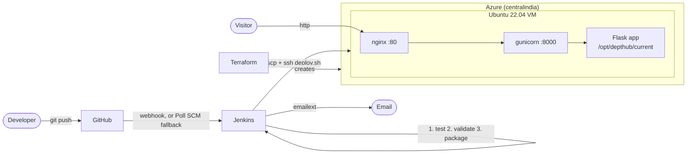

# DeptHub

<!--
Build status badge: only works if Jenkins has a URL that GitHub can reach (GitHub loads README images
from its own servers, so http://localhost:8080 can never work). With a public Jenkins URL, install the
"Embeddable Build Status" plugin, allow anonymous read access to the job, and use:
[](https://YOUR-PUBLIC-JENKINS-URL/job/depthub/)
-->
> **Build status:** Jenkins runs locally in WSL2 in this project, so there is no public build badge. See *Build status badge* below if you host Jenkins somewhere GitHub can reach.

An auto-updating department portal for the **Department of Artificial Intelligence and Data Science, Karunya Institute of Technology and Sciences**.
Edit a JSON file, `git push`, and the live website on Azure updates itself a minute later.

It is also a complete DevOps project: **Terraform** builds the Azure infrastructure, **Jenkins** tests, packages and deploys every commit, and a failed deploy **rolls back automatically**.

## Features

**Website** (Python Flask, no database; content lives in `data/*.json`)
- Notice board with urgent notices pinned at the top in red, colour tags per category and a category filter
- Notices hide themselves after their `expires_on` date
- Live deadline countdowns ("Due in 2d 5h")
- A QR code for every notice (`/qr/<id>`) plus a notice detail page
- Student showcase with portfolio cards and a clickable skill filter
- Footer version badge on every page: `v<build> · commit <hash> · deployed <time ago>`
- Deployment history page (`/deploys`)
- Dark mode (remembered in the browser)
- `/health` endpoint that returns 200 only when both data files load and validate

**Pipeline**
- GitHub webhook trigger, with Poll SCM (every ~2 minutes) as fallback
- Stages: Checkout, Install & Test, Validate Data, Build Package, Deploy to Azure
- Data validation (`scripts/validate_data.py`) stops bad JSON before it reaches the server
- Health check after deploy and **automatic rollback** to the previous release; last 5 releases are kept
- Success and failure emails (Jenkins Email Extension plugin)

## Architecture



How a release is laid out on the VM:

```
/opt/depthub/
├── releases/12/ ... releases/16/   last 5 releases (each has its own venv)
├── current -> releases/16          symlink: the version being served
└── deploy_history.jsonl            one line per deploy, survives every release
```

Deploying = unpack a new folder, move the `current` symlink, restart the service. Rolling back = move the symlink back.

## Repository layout

| Path | What it is |
|---|---|
| `app.py`, `templates/`, `static/` | The Flask web app |
| `data/` | `notices.json`, `students.json` (edit these!) |
| `scripts/validate_data.py` | Data checks, used by Jenkins and `/health` |
| `scripts/make_version.py` | Writes `version.json` at build time |
| `scripts/deploy.sh` | Runs on the VM: install, switch, health check, rollback |
| `tests/` | pytest tests |
| `Jenkinsfile` | The pipeline |
| `terraform/` | Azure infrastructure + cloud-init |
| `docs/` | Report outline and demo script |

## Run it locally

```bash
python -m venv .venv
source .venv/bin/activate          # Windows: .venv\Scripts\activate
pip install -r requirements-dev.txt
pytest                             # run the tests
python scripts/validate_data.py    # check the data files
python scripts/make_version.py     # optional: makes the footer badge show a build
flask --app app run                # open http://127.0.0.1:5000
```

Data file rules (also enforced by the validator): notice `category` is one of `Exam`, `Event`, `Placement`, `General`; dates look like `2026-11-30`; `deadline` (optional) looks like `2026-11-30T17:00:00` (India time); ids are unique.
The sample notices have real dates, so refresh `expires_on` when they run out.

---

## Setup, step by step

**You need:** an Azure subscription, the [Azure CLI](https://learn.microsoft.com/cli/azure/install-azure-cli), [Terraform](https://developer.hashicorp.com/terraform/install), Git, a GitHub account, and a Linux machine for Jenkins (Ubuntu VM, WSL2 Ubuntu, or a Linux PC). The Jenkinsfile uses `sh` steps, so Jenkins on Windows itself is not supported.

### 1. Put the code on GitHub

```bash
git init && git add . && git commit -m "Initial commit"
git branch -M main
git remote add origin https://github.com/<you>/depthub.git
git push -u origin main
```

### 2. Make an SSH key (Azure Linux VMs need an RSA key)

```bash
ssh-keygen -t rsa -b 4096 -f ~/.ssh/depthub_key -N ""
```

`depthub_key.pub` goes to Terraform; the private key `depthub_key` goes to Jenkins (step 5).

### 3. Create the Azure infrastructure with Terraform

```bash
az login
az account show --query id -o tsv      # your subscription id

cd terraform
cp terraform.tfvars.example terraform.tfvars
# edit terraform.tfvars: subscription_id and ssh_public_key_path = "~/.ssh/depthub_key.pub"

terraform init
terraform plan
terraform apply                        # type "yes"
```

Terraform prints `public_ip_address`, `ssh_command`, `ssh_command_alt_port` and `site_url`. Wait 2 to 3 minutes for cloud-init to install nginx and Python, then check:

```bash
ssh -i ~/.ssh/depthub_key azureuser@<public_ip>
cloud-init status --wait               # should say: status: done
```

**Port 22 blocked (college Wi-Fi)?** Many campus networks block outgoing SSH on port 22. The VM therefore also accepts SSH on port **443** (same key-only login), and Jenkins uses it through the `AZURE_SSH_PORT` variable (step 6):

```bash
ssh -p 443 -i ~/.ssh/depthub_key azureuser@<public_ip>
```

**Azure for Students or a restricted subscription?** The default `Standard_B1s` in `centralindia` can be blocked (`NotAvailableForSubscription`), and a policy may only allow a few regions. `terraform plan` does not notice this; only `apply` fails. Check availability first, then set `location` and `vm_size` in `terraform.tfvars` (no code changes needed):

```bash
az vm list-skus --location <region> --size Standard_B1s --resource-type virtualMachines -o table
```

This project ran in `indiasouthcentral`, where B1s is available. (`az vm list-skus` downloads the whole catalogue and can take minutes; the REST endpoint `GET /subscriptions/<id>/providers/Microsoft.Compute/skus?$filter=location eq '<region>'` is much faster.)

Opening the site now shows an nginx "502 Bad Gateway". That is normal until the first deploy.

### 4. Install Jenkins (Ubuntu / WSL2)

```bash
sudo apt update
sudo apt install -y fontconfig openjdk-21-jre git python3 python3-venv openssh-client curl
# Jenkins repository (see https://www.jenkins.io/doc/book/installing/linux/ if these URLs change)
sudo wget -O /etc/apt/keyrings/jenkins-keyring.asc https://pkg.jenkins.io/debian-stable/jenkins.io-2026.key
echo "deb [signed-by=/etc/apt/keyrings/jenkins-keyring.asc] https://pkg.jenkins.io/debian-stable binary/" | sudo tee /etc/apt/sources.list.d/jenkins.list
sudo apt update && sudo apt install -y jenkins
sudo systemctl enable --now jenkins
sudo cat /var/lib/jenkins/secrets/initialAdminPassword
```

Open `http://localhost:8080`, paste that password, and **install the suggested plugins**. Ubuntu 22.04 on current WSL2 already runs systemd; on older WSL2 start it with `sudo service jenkins start`.

**WSL2 stops its VM when no terminal is open**, which would silently stop Jenkins (and Poll SCM). Keep a session open in the background, for example `wsl -d Ubuntu-22.04 -- sleep infinity` in a hidden window, and restart it after a Windows reboot.

The suggested plugins already include most of what is needed. Check these are installed (**Manage Jenkins, Plugins**) and add whatever is missing (SSH Agent and Pipeline Stage View are not in the suggested set):

| Plugin | Why |
|---|---|
| Git | checkout |
| GitHub | `githubPush()` webhook trigger |
| Pipeline | declarative pipelines |
| SSH Agent | `sshagent` step (not in the suggested set) |
| Email Extension | `emailext` step |
| Pipeline Stage View | the stage-by-stage view for screenshots (not in the suggested set) |

Plugins installed from the update center need a Jenkins restart before they load.

### 5. Add the SSH credential

**Manage Jenkins, Credentials, (global), Add Credentials**
- Kind: **SSH Username with private key**
- ID: `azure-vm-ssh` (exactly this, the Jenkinsfile uses it)
- Username: `azureuser`
- Private Key: Enter directly, paste the contents of `~/.ssh/depthub_key`

### 6. Set the global environment variables

**Manage Jenkins, System, Global properties**, tick *Environment variables*, add:

| Name | Value |
|---|---|
| `AZURE_VM_IP` | the `public_ip_address` from Terraform |
| `AZURE_SSH_PORT` | `443` if your network blocks outgoing port 22 (otherwise leave it out: the default is 22) |
| `NOTIFY_EMAIL` | the address that should receive deploy emails |

(You can also type the IP and port into the `VM_IP` and `SSH_PORT` build parameters. The parameters win if both are set.)

### 7. Gmail SMTP for emails

1. Turn on 2-Step Verification for your Google account.
2. Create an **App password** at <https://myaccount.google.com/apppasswords> (16 characters). Your normal password will not work.
3. **Manage Jenkins, System**:
   - *Jenkins Location*, System Admin e-mail address: your Gmail address
   - *Extended E-mail Notification*: SMTP server `smtp.gmail.com`, SMTP port `465`, tick **Use SSL**
   - Click **Advanced**, then next to **Credentials** click **Add, Jenkins** and create a *Username with password* credential (username = your Gmail address, password = the app password, ID `gmail-smtp`). Select it in the dropdown.
   - Save.

To test, run a build and watch for the email, or use the "Test configuration" option in the *E-mail Notification* section (same SMTP settings).

### 8. Create the Jenkins job

**New Item**, name it `depthub`, type **Pipeline**, then:
- Definition: **Pipeline script from SCM**
- SCM: Git, Repository URL: your GitHub repo (add credentials if it is private)
- Branch: `*/main`
- Script Path: `Jenkinsfile`
- Save, then click **Build Now** once.

The first build registers the triggers and parameters from the Jenkinsfile (it may fail at the deploy stage if `AZURE_VM_IP` is not set yet). On that very first build the parameters are still empty, so the Jenkinsfile falls back to defaults (user `azureuser`, port from `AZURE_SSH_PORT`). From then on use **Build with Parameters**, and push-triggered builds start by themselves.

The job's trigger is **Poll SCM** (`H/2 * * * *`, set in the Jenkinsfile): Jenkins asks GitHub for new commits every ~2 minutes, so **no webhook or ngrok is needed**. In this project the full path from `git push` to a green build was about 1 to 2 minutes.

### 9. GitHub webhook (optional)

Only needed if you want builds to start instantly instead of waiting for the next poll.

In the GitHub repo: **Settings, Webhooks, Add webhook**
- Payload URL: `http://<your-jenkins-address>:8080/github-webhook/` (keep the trailing slash)
- Content type: `application/json`
- Events: **Just the push event**

**Jenkins on your own laptop?** GitHub cannot reach `localhost`, so use ngrok:

```bash
ngrok http 8080
```

Use the `https://xxxx.ngrok-free.app` address it prints: payload URL `https://xxxx.ngrok-free.app/github-webhook/`. The free address changes every time you restart ngrok, so update the webhook then.
If the webhook does not work, **Poll SCM** (`H/2 * * * *`) still picks up the commit within about 2 minutes.

### 10. Try it

Edit `data/notices.json`, commit, push. Jenkins builds, the site updates, the email arrives, and `/deploys` shows a new row.

### 11. Save credits: destroy everything

```bash
cd terraform
terraform destroy                      # type "yes"
```

A stopped Azure VM still costs money for its disk and public IP, so destroy it when you are done. Re-create it any time with `terraform apply` (the IP changes, so update `AZURE_VM_IP`).

## Troubleshooting

| Problem | Likely cause |
|---|---|
| Site shows `502 Bad Gateway` | No deploy has run yet, or gunicorn is down: `sudo journalctl -u depthub -n 50` on the VM |
| `terraform apply`: SKU not available / `NotAvailableForSubscription` | The size is blocked for your subscription in that region (common on Azure for Students). Check with the `az vm list-skus` / REST call in step 3, then set `location` and `vm_size` in `terraform.tfvars` |
| SSH or `scp` times out (but the website works) | Your network blocks outgoing port 22 (check with `Test-NetConnection github.com -Port 22`). Use port 443: `ssh -p 443 ...` and set `AZURE_SSH_PORT=443` in Jenkins |
| `terraform plan`: "az executable not found" | The Azure CLI was installed after your terminal opened. Open a new terminal (or add `C:\Program Files\Microsoft SDKs\Azure\CLI2\wbin` to PATH) |
| Provider "timeout while waiting for plugin to start" | The large azurerm provider was slow to start (antivirus, busy machine). Just run the command again |
| Builds stop and Jenkins is unreachable after a while | WSL2 shut down because no terminal was open. Start a keep-alive session (step 4) |
| Build fails at **Install & Test** after you edit the JSON | The tests also validate the real `data/` files, so bad data is stopped there, before Validate Data runs |
| Jenkins: `Permission denied (publickey)` | Wrong private key in the `azure-vm-ssh` credential, or username is not `azureuser` |
| Build fails at Validate Data | Your JSON is wrong. The console shows the exact field. The live site is unchanged |
| Deploy stage fails and the site shows the old version | That is the rollback working. See the console for the health check output |
| No emails | App password not used, `NOTIFY_EMAIL` not set, or SSL/port wrong (use 465 with SSL) |
| `python3 -m venv` fails on the Jenkins machine | `sudo apt install python3-venv` |
| SSH host key warning | The Jenkinsfile disables host-key checking on purpose, because a re-created VM has a new key |

## Build status badge

GitHub shows README images by fetching them from its own servers, so a badge served by Jenkins on `http://localhost:8080` can never load there. If you host Jenkins at a public address:

1. Install the **Embeddable Build Status** plugin.
2. Give anonymous users *Read* access to the job (or use the plugin's token-protected badge links).
3. Add this to the top of the README:

```markdown
[](https://YOUR-PUBLIC-JENKINS-URL/job/depthub/)
```

For the report, a screenshot of the Jenkins Stage View is a better proof of build status for a locally hosted Jenkins.
