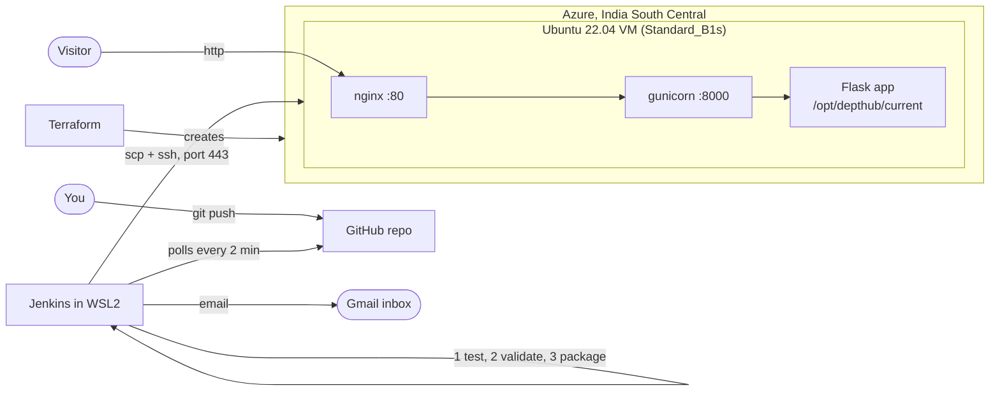

# DeptHub: the whole project, explained

This document explains everything about DeptHub in plain language: what it is, how every part works, what we actually did to get it live, the problems we hit and how we solved them, and how to talk about it in a demo or viva.

---

## 1. The one-paragraph summary

DeptHub is a small website for the **Department of Artificial Intelligence and Data Science, Karunya Institute of Technology and Sciences**. It shows notices (exams, events, placements), a student showcase, and a deployment history page. The interesting part is not the website itself but **how it gets to the internet**: **Terraform** creates a Linux server on **Microsoft Azure**, and **Jenkins** watches the GitHub repository. Whenever someone pushes a commit, Jenkins tests the code, checks the data, packages the app, copies it to the Azure server and switches the live site to the new version. If the new version is broken, the server **automatically rolls back** to the last working version, and an **email** reports what happened. Nobody has to log in to the server by hand.

---

## 2. Live facts (as deployed)

| Item | Value |
|---|---|
| Live website | http://172.198.62.151/ |
| GitHub repository | https://github.com/mikey1803/depthub |
| Jenkins | http://localhost:8080/job/depthub/ (runs on this laptop, inside WSL2 Ubuntu 22.04) |
| Azure region | India South Central (`indiasouthcentral`) |
| Azure VM | `depthub-vm`, size `Standard_B1s` (1 vCPU, 1 GB RAM), Ubuntu 22.04 |
| Resource group | `depthub-rg` (8 resources) |
| SSH ports | 22 and 443 (key-only login) |
| Website port | 80 |
| Trigger | Poll SCM every ~2 minutes (`H/2 * * * *`) |
| Email | Gmail SMTP via the Jenkins Email Extension plugin, to piomicheal17@gmail.com |

---

## 3. The big picture



There are four big pieces:

1. **The web app** (Python Flask): the thing people see.
2. **Terraform**: builds the Azure server and its network, as code.
3. **Jenkins**: the robot that tests and deploys every commit.
4. **The deploy script** on the server: installs the new version safely and rolls back if it is broken.

---

## 4. The web app

### 4.1 What it does

| Page | URL | What it shows |
|---|---|---|
| Notice board | `/` | Active notices. Urgent ones pinned at the top in red, colour tags per category, filter by category, a "Next deadline" countdown in the hero |
| Notice detail | `/notice/<id>` | One notice, its dates, a live countdown and a QR code |
| QR code | `/qr/<id>` | A PNG QR code that opens that notice's page |
| Student showcase | `/students` | Portfolio cards; click a skill (e.g. Python) to see only students with it |
| Deployments | `/deploys` | Every deployment: build number, commit, message, author, time, and whether it went live or was rolled back |
| Health check | `/health` | `200 {"status":"ok"}` only if both data files load and are valid, otherwise `500` |

Every page has a footer badge like `v8 · commit 836d046 · deployed 3 minutes ago`, and a dark mode toggle that remembers your choice.

### 4.2 How it works (no database)

All content lives in two JSON files in the repo:

- `data/notices.json`: each notice has `id`, `title`, `body`, `category` (Exam / Event / Placement / General), `urgent`, `posted_on`, optional `deadline`, and `expires_on`.
- `data/students.json`: each student has `name`, `role`, `skills`, `projects` (title, description, link) and `github`.

So "posting a notice" means **editing a JSON file and pushing it to GitHub**. The pipeline does the rest.

Smart behaviour built into `app.py`:

- **Auto-expiring notices**: a notice whose `expires_on` date has passed is simply not shown (and its page returns 404). Dates use **India time (IST)**, because the server runs on UTC and would otherwise expire notices 5.5 hours late.
- **Urgent first**: notices are sorted urgent first, then newest first.
- **Countdowns**: the server sends each deadline with its time zone (e.g. `2026-11-03T16:00:00+05:30`), and a little JavaScript updates "Due in 9d 16h" every second.
- **QR codes**: made with the Python `qrcode` library on the fly.
- **Version badge**: read from `version.json`, a file Jenkins writes at build time (build number, commit, message, author, time).
- **Deploy history**: read from `/opt/depthub/deploy_history.jsonl` on the server. That file sits **outside** the release folders, so it survives every deployment.

### 4.3 The design

The frontend was redesigned in an **Apple-inspired style**, in plain CSS with no frameworks: Apple's system font, a light grey background, white rounded cards, a frosted (blurred) sticky top bar, iOS-style segmented filters and grouped lists, grey initial circles like Apple Contacts, one blue accent colour, light and dark themes, and gentle fade-up animations that switch off when the device asks for reduced motion. Icons come from the open-source Phosphor set (the closest free match to Apple's SF Symbols).

> **Status:** the redesign is finished and tested locally (33 tests pass) but **not yet committed or pushed**, so the live site still shows the previous design until it is pushed.

---

## 5. Quality checks: validation and tests

### 5.1 Data validation (`scripts/validate_data.py`)

This script checks both JSON files and **exits with an error code if anything is wrong**. It checks:

- every required field exists, and there are no unknown fields (catches typos like `deadlne`)
- types are right (`id` is a number, `urgent` is true/false, skills is a list, ...)
- dates are real dates in the right format (`2026-02-30` fails)
- `expires_on` is not before `posted_on`
- ids and student names are unique
- category is one of the four allowed ones
- project links start with `http://` or `https://`

The same code is used in two places: Jenkins runs it before deploying, and the `/health` endpoint uses it on the live server.

### 5.2 Automated tests (`tests/`, pytest, 33 tests)

They check, among other things: all pages return 200, expired notices are hidden, urgent notices come first, filters work, the QR route returns a PNG, the footer badge and deploy history render, `/health` returns 500 for broken or missing data, and the validator catches each kind of bad data. One test also validates the **real** `data/` folder, which is why bad data is usually caught at the test stage.

---

## 6. Terraform: the Azure infrastructure

Terraform is **Infrastructure as Code**: instead of clicking around the Azure portal, the server and network are described in files, and `terraform apply` creates them. `terraform destroy` removes everything again. The same files always produce the same setup.

### 6.1 The 8 resources (`terraform/main.tf`)

| Resource | In simple words |
|---|---|
| Resource group `depthub-rg` | A folder that holds everything. Deleting it deletes all of it |
| Virtual network `10.0.0.0/16` | Our private network in Azure |
| Subnet `10.0.1.0/24` | The slice of that network where the VM lives |
| Network security group | The firewall: only allows ports **22** (SSH), **443** (SSH fallback) and **80** (website) |
| Public IP (static) | The internet address `172.198.62.151`. Static, so it does not change |
| Network interface | The VM's network card, connected to the subnet and the public IP |
| NIC to NSG association | Attaches the firewall rules to the network card |
| Linux VM | Ubuntu 22.04, `Standard_B1s`, SSH key login only (no passwords) |

### 6.2 Other Terraform files

- `variables.tf`: everything adjustable (subscription, **region**, **VM size**, image, SSH key path, the extra SSH port). Region and size are variables so they can be changed without editing the main code.
- `terraform.tfvars`: our actual values. **Git-ignored**, never committed.
- `outputs.tf`: prints the public IP, SSH commands and site URL after `apply`.
- `cloud-init.yaml`: a script that runs **once on the VM's first boot**. It installs Python, venv and nginx; sets nginx up as a reverse proxy to port 8000; creates the `depthub` systemd service; makes `sshd` also listen on port 443; and allows the deploy user to restart only that one service without a password.
- `.terraform.lock.hcl`: pins the exact provider version (azurerm 4.81.0) so everyone gets the same one.

### 6.3 How the server serves the site

```
Visitor --> nginx (port 80) --> gunicorn (127.0.0.1:8000) --> Flask app in /opt/depthub/current
```

- **nginx** faces the internet and passes requests on (a "reverse proxy").
- **gunicorn** is a proper production server for Python apps (Flask's built-in server is only for development).
- **systemd** keeps gunicorn running and restarts it if it crashes.

---

## 7. Jenkins: the CI/CD pipeline

**CI/CD** means Continuous Integration / Continuous Deployment: every change is automatically tested and, if it passes, automatically deployed.

### 7.1 Where Jenkins runs

Jenkins runs on this laptop inside **WSL2 Ubuntu 22.04** (Linux inside Windows), with Java 21. It is reachable at http://localhost:8080. WSL shuts itself down when no terminal is open, which would stop Jenkins, so a hidden background session keeps it alive. That session must be restarted after a reboot.

### 7.2 The trigger

The `Jenkinsfile` has two triggers:

- `pollSCM('H/2 * * * *')`: Jenkins asks GitHub "any new commits?" about every 2 minutes. **This is what we use.**
- `githubPush()`: would let GitHub notify Jenkins instantly through a webhook. It needs Jenkins to be reachable from the internet (e.g. with ngrok), so we did not set it up; polling is allowed by the assignment.

### 7.3 The stages

| Stage | What happens |
|---|---|
| Checkout | Gets the latest code from GitHub; records the commit message and author |
| Install & Test | Creates a Python virtual environment, installs packages, runs the 33 tests |
| Validate Data | Runs `validate_data.py` on the JSON files |
| Build Package | Writes `version.json` and packs the app into `depthub-<build>.tar.gz` |
| Deploy to Azure | Copies the package and `deploy.sh` to the VM (`scp`), then runs `deploy.sh` there (`ssh`) |
| Post: emails | Success: "New DeptHub deploy live: v<build>". Failure: what failed, and whether it was rolled back |

If any stage fails, the later stages do not run, so **broken code or bad data never reaches the server**.

### 7.4 Settings Jenkins needs

| Setting | Value / purpose |
|---|---|
| Credential `azure-vm-ssh` | The SSH private key for user `azureuser` (stored encrypted in Jenkins) |
| `AZURE_VM_IP` | `172.198.62.151` |
| `AZURE_SSH_PORT` | `443` (works on campus Wi-Fi, which blocks port 22) |
| `NOTIFY_EMAIL` | Who gets the emails |
| Gmail credential | Gmail address plus a 16-letter **app password** (typed only by you in the Jenkins UI) |
| Plugins | Git, GitHub, Pipeline, SSH Agent, Email Extension, Pipeline Stage View |
| `SKIP_CHECKS` parameter | Demo only: skips tests and validation so the rollback can be shown |

---

## 8. The deploy script and automatic rollback

`scripts/deploy.sh` runs **on the VM**. This is the heart of "safe deployment".

### 8.1 How releases are stored

```
/opt/depthub/
├── releases/
│   ├── 4/            one folder per build, each with its own Python venv
│   ├── 7/
│   └── 8/
├── current -> releases/8     a symlink: "this is the live version"
└── deploy_history.jsonl      one line per deployment, never deleted
```

The systemd service always runs whatever `current` points to. So **deploying = point the symlink at a new folder and restart**, and **rolling back = point it back**. Switching a symlink is instant and atomic (it can never be "half switched").

### 8.2 Step by step

1. Remember which release is live now (the "previous" one).
2. Unpack the new package into `releases/<build>`.
3. Create a venv and install the requirements. If this fails, stop: the live site was never touched.
4. Switch `current` to the new release and restart the service.
5. **Health check**: call `/health` up to 10 times, 3 seconds apart.
6. **Healthy?** Write a `success` line to the history and delete old releases, keeping the newest 5.
7. **Not healthy?** Write a `rolled-back` line to the history, switch `current` back to the previous release, restart, check it is healthy again, delete the broken release, and **exit with code 1** so Jenkins marks the build as failed and sends the failure email.

---

## 9. What we actually did, in order

### Phase 1: build and test locally
- Wrote the Flask app, templates, CSS and JavaScript, the seed data, the validator, the tests, the deploy script, the Jenkinsfile, the Terraform files and the docs.
- Ran the tests and the app locally and checked it in a browser.
- Ran `terraform fmt` and `terraform validate`.

### Phase 2: tools and accounts
- Created the git repo, then the public GitHub repo with the GitHub CLI.
- Added `.gitattributes` to force Linux line endings (a Windows-style `deploy.sh` would fail on Linux).
- Generated an RSA 4096 SSH key (Azure only accepts RSA keys).
- Installed the Azure CLI and Terraform, and logged in to Azure (the first login used an account with no subscription; the second used the **Azure for Students** one).

### Phase 3: Azure
- **Problem:** `Standard_B1s` was blocked for the student subscription in Central India (`NotAvailableForSubscription`), and a policy only allowed 5 regions. `terraform plan` cannot see this; only `apply` would have failed.
- **Solution:** checked every allowed region through the Azure API and found B1s available in **India South Central**. Changed only `location` in `terraform.tfvars`.
- `terraform apply` created the 8 resources.
- **Problem:** SSH timed out, though the website port worked. Tests showed the **campus network blocks outgoing port 22** (even `github.com:22` was blocked).
- **Solution:** made the VM also accept SSH on port **443**, which is almost never blocked (new firewall rule plus a cloud-init setting), and gave the Jenkinsfile an `SSH_PORT` setting. Re-applying replaced the VM (cloud-init only runs at first boot); the IP stayed the same. Verified SSH on both ports.

### Phase 4: Jenkins
- Installed Ubuntu 22.04 in WSL2, Java 21 and Jenkins (from the official pkg.jenkins.io repository).
- You did the setup wizard and created the admin user; you created an API token and typed it at a hidden prompt, so no password ever went through the chat.
- Installed the missing SSH Agent plugin, then created the SSH credential, the global variables, the Gmail SMTP settings and the `depthub` pipeline job automatically through the Jenkins script console.
- You created a Gmail app password and typed it into Jenkins yourself.

### Phase 5: first builds
- **Build #1 failed** at deploy: the SSH user was empty because Jenkins does not know the Jenkinsfile's parameters on the very first build. Fixed with a default (`azureuser`). Also fixed the failure email so it only says "rolled back" when a rollback really happened.
- **Build #2 succeeded**: the first real run of `deploy.sh`. The site went live.

### Phase 6: proving continuous deployment
- Changed the notice dates, committed and pushed, and touched nothing else.
- About 1.5 minutes later Jenkins started **build #4 by itself** ("Started by an SCM change"), and the site updated to v4.

### Phase 7: proving the safety nets
- Pushed a notice with a fake category (`Gossip`). **Build #5** (started automatically) **failed at Install & Test**; nothing was deployed and the site stayed on v4.
- Ran **build #6** with `SKIP_CHECKS=true`, so the broken data reached the server. `/health` failed 10 times, `deploy.sh` **rolled back to release 4**, and the build failed. The site never went down, and `/deploys` showed `v6 rolled-back`.
- Reverted the bad commit; **build #7** redeployed good data automatically. Build #8 deployed the documentation update.

### Phase 8: polish
- Installed the Pipeline Stage View plugin for screenshots, updated the README and the demo script, wrote `docs/setup-log.md`, deleted the stored API token file, and finally redesigned the frontend in an Apple style (not pushed yet).

---

## 10. Build history (what Jenkins shows)

| Build | How it started | Result | What it shows |
|---|---|---|---|
| #1 | Manual | Failed at deploy | Empty SSH user on first build (fixed) |
| #2 | Manual | Success | First real deployment |
| #3 | Poll SCM | Success | Automatic build after a cleanup commit |
| #4 | Poll SCM | Success | **Continuous deployment proof** |
| #5 | Poll SCM | Failed at Install & Test | **Bad data stopped before deploy** |
| #6 | Manual, `SKIP_CHECKS=true` | Failed, rolled back | **Automatic rollback proof** |
| #7 | Poll SCM | Success | Good data restored automatically |
| #8 | Poll SCM | Success | Docs update; current live version |

---

## 11. Security choices

- **No passwords on the VM**: SSH key login only.
- **Secrets never committed**: `terraform.tfvars`, the Terraform state, keys and `.env` files are git-ignored, and every commit was scanned before pushing.
- **Secrets never typed into the chat**: Jenkins admin password, API token and Gmail app password were all typed by you directly into Jenkins or a hidden terminal prompt. The API token file was deleted afterwards (also revoke the token in Jenkins).
- **Least privilege**: the deploy user may restart only the `depthub` service with sudo, nothing else.
- **Firewall**: only ports 22, 443 and 80 are open.
- **Trade-off to mention**: SSH is open to the whole internet (key-only) because Jenkins runs on a laptop whose IP changes. Host-key checking is turned off in the pipeline because a re-created VM gets a new key. Both are acceptable for a student project but would be tightened in production.

---

## 12. Every file, briefly

| File | Purpose |
|---|---|
| `app.py` | The Flask app: routes, notice logic, QR codes, health check, version badge, history |
| `templates/*.html` | The pages (Jinja templates) |
| `static/style.css`, `static/app.js` | Design, dark mode, countdowns, animations |
| `data/notices.json`, `data/students.json` | The content |
| `scripts/validate_data.py` | Data checks (pipeline and `/health`) |
| `scripts/make_version.py` | Writes `version.json` at build time |
| `scripts/deploy.sh` | Install, switch, health check, rollback, cleanup (runs on the VM) |
| `tests/` | 33 pytest tests |
| `Jenkinsfile` | The pipeline: triggers, stages, deploy, emails |
| `terraform/` | Azure infrastructure and first-boot setup |
| `requirements.txt` | Flask, qrcode, gunicorn (pinned versions) |
| `.gitignore`, `.gitattributes` | Keep secrets out of git; force Linux line endings |
| `README.md` | Setup guide and troubleshooting |
| `docs/setup-log.md` | Detailed log of the real setup (for the report's Observations) |
| `docs/report-outline.md` | Report structure and screenshot checklist |
| `docs/demo-script.md` | 2-minute live demo script |

---

## 13. Key concepts, in one line each

- **Infrastructure as Code (IaC)**: describing servers and networks in files so they can be created, changed and destroyed reliably (Terraform).
- **CI (Continuous Integration)**: every change is automatically built and tested.
- **CD (Continuous Deployment)**: every change that passes is automatically released to the live site.
- **Poll SCM vs webhook**: polling means Jenkins asks GitHub regularly; a webhook means GitHub tells Jenkins instantly.
- **Reverse proxy (nginx)**: the front door that receives web traffic and hands it to the app server.
- **systemd service**: Linux's way of keeping a program running and restarting it if it stops.
- **Symlink release switching**: each version in its own folder, with one pointer to the live one; switching is instant and reversible.
- **Health check**: an endpoint the deploy script calls to decide whether the new version really works.
- **Rollback**: returning to the last working version automatically when the new one fails.
- **cloud-init**: a script the VM runs on its first boot to set itself up.

---

## 14. Likely viva questions, with short answers

**Why Terraform instead of creating the VM in the portal?** It is repeatable and reviewable: the same files always create the same setup, it lives in git, and `terraform destroy` cleans up completely.

**What happens when I push a commit?** Within about 2 minutes Jenkins notices it, runs the tests and validation, packages the app, copies it to the VM and runs `deploy.sh`, which switches the live version, checks `/health`, and emails the result.

**How does rollback work?** Each release is a separate folder and `current` is a symlink. If `/health` fails after a deploy, the script points the symlink back to the previous folder, restarts, and fails the build.

**What stops bad data from going live?** Two layers: the tests and the validator stop it in Jenkins, and if something still gets through, the health check on the server triggers a rollback.

**Why Poll SCM and not a webhook?** Jenkins runs on a laptop that GitHub cannot reach. Polling needs no public address and is allowed by the assignment.

**Why is SSH on port 443 as well?** The campus network blocks outgoing port 22. Port 443 is almost never blocked, so the pipeline works from campus too.

**Why India South Central and not Central India?** The B1s size was blocked for the student subscription in Central India; it was available in India South Central, which is also allowed by the subscription's policy.

**Where is the deploy history kept, and why there?** In `/opt/depthub/deploy_history.jsonl`, outside the release folders, so it is not deleted when old releases are cleaned up.

**Why gunicorn and nginx instead of `flask run`?** Flask's built-in server is for development only. gunicorn handles real traffic with multiple workers, and nginx is a fast, secure front door.

**How are secrets handled?** Keys and passwords live only in Jenkins' encrypted credential store or in git-ignored local files; nothing secret is in the repository.

---

## 15. Costs and cleanup

- Running cost is roughly **$0.40 to $0.50 per day** from the student credit (VM, static public IP and disk). This is an estimate, not a quoted price.
- After the evaluation, run:

```bash
cd terraform
terraform destroy
```

- Keep `terraform/terraform.tfstate` until then: Terraform needs it to know what to delete.
- To bring everything back later: `terraform apply`, then update `AZURE_VM_IP` in Jenkins if the IP changed.

---

## 16. What is left to do

1. Commit and push the Apple-style redesign so Jenkins deploys it.
2. Take the remaining report screenshots (list in `docs/report-outline.md`).
3. Confirm the success and failure emails arrived in the inbox.
4. Revoke the setup API token in Jenkins (your name, then Security).
5. Run `terraform destroy` after the evaluation.
